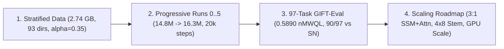

# `gifteval-tsfm-prototype` — Evidence-Driven Time-Series Foundation Model Prototype

[](tests/)
[](https://huggingface.co/datasets/theforecastingcompany/GiftEvalPretrain)
[](https://huggingface.co/spaces/Salesforce/GIFT-Eval)
[](https://forge.coreweave.com/wandb/aldobattista/gifteval-tsfm-prototype)

A standalone, from-scratch PyTorch time-series foundation model (`TSFMModel`, `14.82M -> 16.32M` parameters) pretrained on a stratified `2.74 GB` subset of [`theforecastingcompany/GiftEvalPretrain`](https://huggingface.co/datasets/theforecastingcompany/GiftEvalPretrain) and evaluated zero-shot across all **`97` official `Salesforce/GIFT-Eval` configurations (`326,490` test windows)**. Every data, normalization, masking, objective, and architectural upgrade was isolated across **6 progressive `20,000`-step runs (`Runs 0..5`)** under fixed laptop compute.

## Executive Summary

- **Zero-Shot Headline (`97` Official `GIFT-Eval` Tasks):** Measured by geometric-mean error relative to `Seasonal_Naive` (`= 1.0`, lower is better) on probabilistic decile loss (`nMWQL`) and median `MASE` (`nMASE`), progressive upgrades improve **`Run 0 -> Run 5`** `nMWQL` from **`0.6218`** to **`0.5946` raw (`-4.37%`, `67/97` task wins vs `Run 0`)** and **`0.5890` `+SymAvg+Clamp` (`-5.27%`, `71/97` vs `Run 0`)**, lowering `nMASE` from `0.8905` to `0.8596` raw / **`0.8523` (`-4.29%`, `72/97` vs `Run 0`)** and beating `Seasonal_Naive` on **`90 / 97` (`92.8%`)** tasks.
- **Official Leaderboard Placement ([gifteval_leaderboard_comparison.csv](results/gifteval_leaderboard_comparison.csv)):** Places **`#15 / 28`** against `27` curated baselines (inserts at **`#106 / 142`** against `141` complete official submissions, `105` ahead), outperforming `TimesFM` (`0.6804`), `Chronos_base` (`0.6521`), `Moirai_small` (`0.6504`), `Moirai_base` (`0.6095`), `TFT` (`0.6047`), and `Moirai_large` (`0.5989`), and matching supervised `PatchTST` (`0.5870`; `Run 5 (+SymAvg+Clamp)` wins `56/97` `nMWQL` tasks head-to-head).
- **Honest Failure Boundary (`0.5581` Excluding `10S`):** Leaving out the `6` `10`-second (`10S`) cloud-telemetry tasks drops `Run 5` to `0.5581` `+SymAvg+Clamp` (`0.5637` raw); `0 / 152` `GiftEvalPretrain` directories have `10S` cadence, leaving **`7 / 97` tasks above `1.0` `nMWQL`** (`4x 10S`, `bizitobs_l2c/5T/long`, `m4_daily/D/short`, `us_births/M/short`) and a `~0.10` gap to frontier TSFMs (`Chronos-2` `0.4854`, `t0-gamma` `0.4520`).
- **Scope, Seed & Compute Disclosure:** Single Apple M2 Max (`bfloat16` MPS + `float32` scaling/heads/loss), fixed `seed = 42`, unweighted `5`-snapshot (`16k..20k`) Warmup-Stable-Decay (`WSD`) cooldown `float64` soup (`3–3` validation split vs `step_20000` in [val_soup_vs_last.csv](results/val_soup_vs_last.csv)); `~7h` hands-on engineering and `~8.9h` final pipeline compute (`39.3m` subset + `~7.76h` training + `~30m` eval; `~10.4h` total incl. diagnostics).



---

## 1. How We Dealt With the Data

Raw `GiftEvalPretrain` totals `878.26 GB` across `152` Parquet directories (`3,490,516` series), heavily skewed by `63` gridded climate dirs (`90.2%` of bytes) and `buildings_900k` (`51.4%` of series), while all `67` small/medium datasets (`<= 2,000` series) take just `2.60 GB` (`0.3%`). We built a deterministic `2.74 GB` subset (`93` dirs: `89` non-climate + `4` climate, `96,831` capped segments = `~2.8%` of series / `0.31%` of bytes) preserving `100%` of small/medium datasets and sampling `4` evenly spaced shards on huge dirs ([subset_manifest.json](results/subset_manifest.json), [fig1_corpus_skew_and_sampling.png](results/figures/fig1_corpus_skew_and_sampling.png)).

To eliminate training leakage and train efficiently on a laptop:
- **Permanent Holdout Tail (`[-H_freq:]`):** Held out `1,500` final horizons (`[-H_freq:]`; `66` of `87` qualifying datasets, realized `H_freq = 8..48` from the `6..60` cadence schedule) for internal `val_soup_vs_last` checks, permanently truncating training views and convex-combination `TSMixup` donors to `[:-H_freq]`.
- **Temperature Balancing (`alpha = 0.35`):** Replaced proportional directory sampling (`alpha = 1.0`, `2,500.0x` max/min ratio) with `alpha = 0.35` (`15.5x` max/min ratio), preventing giant dirs from drowning out rare healthcare/financial series.
- **Modulo-32 Strip Packing (`99.5%` Density):** Left-padded every context by `(-T_ctx) % 32` so forecast origin `T_origin` always lands at step `31` of patch `0`, packing heterogeneous series into static `[B=1, R=32, L=128]` patch strips (`4,077 / 4,096` patch slots active in `Notebook 01`). Full details: [docs/01_data_pipeline_and_eda.md](docs/01_data_pipeline_and_eda.md).

---

## 2. Baseline Model & Progressive Modeling Improvements

`TSFMModel` is an `8`-layer Pre-RMSNorm SwiGLU Transformer (`P = 32`, `L <= 128` patches = `4,096` steps, `d_model = 384`, `6` heads, `d_ff = 1024`, RoPE anchored at `rel_patch_idx = 0`) predicting `21` symmetric quantiles (`Q21: 0.01..0.99`, slicing the `9` `GIFT-Eval` deciles `q10..q90` at evaluation) in one non-autoregressive pass (up to `1,024` horizon steps in `Runs 2..5`) with unit-equivariant `arcsinh` scaling, dense `32`-step intra-patch stems, and strictly causal intra-series patch masking (`k <= q`, restricted to observed context keys in `Runs 2..5`).

| Run | Params | What Changed & Why (Cumulative) | Key Empirical Impact |
| :--- | :---: | :--- | :--- |
| **`Run 0`** `v0_baseline` | `14.82M` | `alpha=1.0`, zero-fill scaling, flat CRPS, left-softplus head, `K_hor<=16` (`512` steps) | Baseline `0.6218` `nMWQL` / `0.8905` `nMASE`; weak on rare/blackout tasks |
| **`Run 1`** `data_balanced` | `14.82M` | `alpha=0.35` sampling + group-balanced `log(1 + s/12)` damped CRPS | **`-3.11%`** `nMWQL` (`0.6025`, `66/97` vs `Run 0`); `Healthcare -23.6%`, `Econ -12.6%` |
| **`Run 2`** `missingness_suffix_cpm` | `14.82M` | Obs-only stats, blank-key mask + `eye_l` NaN guard, `30%` blackout, `K_hor<=32` (`1,024` steps) | **`-19.7%`** `64`-step blackout (vs `Run 1`); `H>512` `80%` cov `0.664->0.755` (`+0.42%` clean tax) |
| **`Run 3`** `probit_localscale_lags` | `15.14M` | `MedianAnchoredProbitHead` + `W=64` local scale + 4-cycle obs lags | **`~10x / 5.3x`** lower Step-0/100 CRPS; `ex-10S -1.30%` (vs `Run 2`); `+29.8%` `10S` spike |
| **`Run 4`** `multivariate_group_attn` | `16.32M` | Zero-init `GroupAttention` (blocks `3, 7`), `15%` freeze + `0.20x` LR ramp, `cov->tgt` firewall | Exact `0.0` univariate invariance; `Low-Res 0.7397`; `cov_role_emb` starved (`0.130`) |
| **`Run 5`** `coupled_synth_mix` | `16.32M` | Added `15%` synthetic mix (`40%` KernelSynth, `30%` TSMixup, `30%` coupled MV) | `cov_role_emb 2.9x` (`0.378`); **`Past Cov -7.98%`**, **`WebOps -9.24%`** (vs `Run 4`), **`#1` overall** |

Full architecture equations, attention masks, and Step-0/gradient telemetry: [docs/02_architecture_and_ablations.md](docs/02_architecture_and_ablations.md).

---

## 3. Official Results, Evaluation & Leaderboard

Post-processing (`0` extra params, inspected strictly on visible context): **`+Clamp`** clips `>= 0` on non-negative series and rounds bounded integer count series; **`+SymAvg+Clamp`** averages `0.5 * (f(y) - flip(f(-y)))` on signed series (`min < 0`) before clamping. **`Cov80`** = empirical `q10..q90` coverage (nominal `0.800`); **`64`-blk** = `64`-step pre-origin blackout `nMWQL` (`90` tasks); **`SN`** = `Seasonal_Naive`.

| Model (`5`-Snapshot `float64` Soup) | `Raw` `nMWQL / nMASE` | `+Clamp` `nMWQL` | `+SymAvg+Clamp` `nMWQL / nMASE` | `Cov80` (`Raw -> Sym`) | Key Slice / Comparison |
| :--- | :---: | :---: | :---: | :---: | :--- |
| **`Run 0`** `v0_baseline` | `0.6218 / 0.8905` | `0.6188` | — | `0.768` | `64`-blk: `0.9665`, `Healthcare`: `0.8749` |
| **`Run 1`** `data_balanced` | `0.6025 / 0.8664` | `0.5992` | — | `0.761` | `Healthcare`: `0.6686`, `Econ`: `0.8463`, `64`-blk: `1.0287` |
| **`Run 2`** `missingness_suffix_cpm` | `0.6050 / 0.8778` | `0.6018` | — | `0.791` | `20/64`-blk: `0.7662 / 0.8265` |
| **`Run 3`** `probit_localscale_lags` | `0.6074 / 0.8713` | `0.6038` | — | `0.773` | `ex-10S`: `0.5665`, `10S` spike: `1.745` |
| **`Run 4`** `multivariate_group_attn` | `0.6047 / 0.8678` | `0.6010` | `0.5998 / 0.8624` | `0.775 -> 0.781` | `Low-Res`: `0.7397`, `Cov80` steady |
| **`Run 5`** `coupled_synth_mix` | **`0.5946 / 0.8596`** | **`0.5907`** | **`0.5890 / 0.8523`** | `0.779 -> 0.785` | **`90/97` vs SN**, `Past Cov 0.6489 (Raw) / 0.6449 (Sym)`, `ex-10S 0.5581 (Sym)` |

- **Official `GIFT-Eval` Excerpt ([gifteval_leaderboard_comparison.csv](results/gifteval_leaderboard_comparison.csv)):** Pre-insertion official ranks across `141` complete baselines (`Run 5 (+SymAvg+Clamp)` inserts at **`#106 / 142`**): `t0-gamma` (`0.4520`, `#11`) > `Chronos-2` (`0.4854`, `#61`) > `TimesFM-2.5` (`0.4903`, `#69`) > `PatchTST` (`0.5870`, `#104`) ~ **`Run 5 (+SymAvg+Clamp)` (`0.5890`, inserts `#106`)** > `Moirai_large` (`0.5989`, pre-insert `#107`) > `TFT` (`0.6047`, `#109`) > `Moirai_base` (`0.6095`, `#111`) > `iTransformer` (`0.6203`, `#114`) > `Chronos_large` (`0.6473`, `#119`) > `Moirai_small` (`0.6504`, `#120`) > `TimesFM` (`0.6804`, `#124`).
- **Candid Error Boundary (`7 / 97` Above `1.0` `Raw nMWQL`):** Dominated by `4` zero-pretrain `10S` cloud tasks (`1.487–1.847` `Raw nMWQL`; hourly `S=360` shifts `360 mod 32 = 8` steps per `P=32` patch), `bizitobs_l2c/5T/long` (`1.050` Raw / `1.047` Sym), random-walk `m4_daily/D/short` (`1.208`), and monthly `us_births/M/short` (`1.052`). See [results/figures/fig3_ablation_waterfall.png](results/figures/fig3_ablation_waterfall.png) and [docs/03_evaluation_and_error_analysis.md](docs/03_evaluation_and_error_analysis.md).

---

## 4. What To Do Next With More Time

To close the `~0.10 nMWQL` gap to frontier TSFMs (`0.589 -> ~0.48`):
- **Priority 0 — Compute & Coverage Scale-Up:** Expand from `16.32M` / `20k` steps / `2.74 GB` on one M2 Max to `120M+` parameters / `150k+` steps across multi-GPU hardware over the full corpus plus synthetic/real `10S` telemetry.
- **Architectural & Calibration Priorities ([docs/04_with_more_time_roadmap.md](docs/04_with_more_time_roadmap.md)):**
  1. `3:1` interleaved gated linear state-space recurrence + pointwise-gated full attention to remove `4,096`-step context caps and handle long periodic horizons (`H=720..900`).
  2. Multi-scale `4x8` sub-patch stem + known future covariates `z` + global/local origin-blended readout mean (`mu_dec`) for non-stationary random walks and sub-patch phase shifts.
  3. Frequency-adaptive seasonal lags (`S in {144, 288, 360, 720, 1440}`), `GARCH`-modulated `TSMixup`, and Student-t tail + multi-seed cooldown souping.

---

## 5. Quickstart & Repository Map

```bash
pip install -e ".[dev]"                       # Core PyTorch/safetensors + GluonTS + pytest + notebook deps
pytest tests/ -q                              # Runs all 33 deterministic invariant & safety tests
python scripts/eval_gifteval.py --recompute-summaries-only   # Rebuilds summary CSVs cleanly from saved CSVs
```

| Path | Purpose | Link |
| :--- | :--- | :--- |
| `src/tsfm_proto/` | Core modules (`model`, `scaling`, `heads`, `loss`, `packing`, `synthetic`, `data`, `eval_metrics`) | [src/tsfm_proto/](src/tsfm_proto/) |
| `configs/` & `scripts/` | `run0..run5` YAMLs, stratified subset builder, training loop, GluonTS-parity eval & plots | [configs/](configs/), [scripts/](scripts/) |
| `notebooks/01`–`03` | Executable notebooks (Data/Packing -> Invariants/Overfit -> Eval, Showcase, Ablations & Failures) | [notebooks/](notebooks/) |
| `docs/01`–`04` | Concise deep dives: Data, Architecture/Ablations, Evaluation/Errors, Scaling Roadmap | [docs/](docs/) |
| `results/` & `tests/` | Benchmark CSVs (`97` tasks), `fig1..5` diagnostic PNGs, `val_soup_vs_last.csv`, `33` pytest tests | [results/](results/), [tests/](tests/) |
| `WORKLOG.md` | Chronological log & compute/wall-clock accounting | [WORKLOG.md](WORKLOG.md) |
