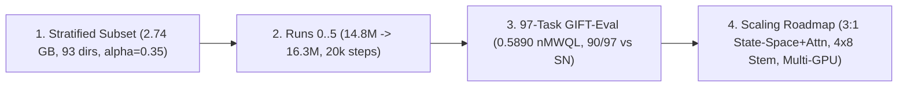
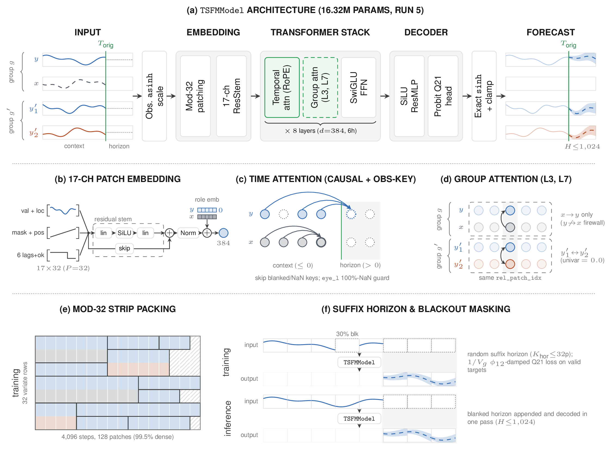
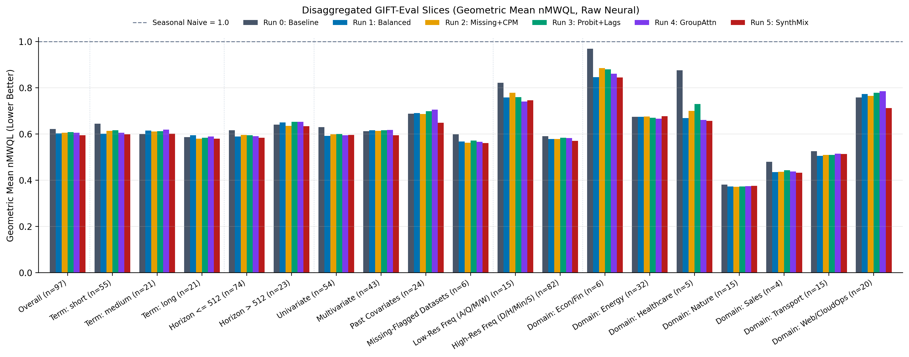

# `gifteval-tsfm-prototype` — Time-Series Foundation Model Prototype

[](tests/)
[](https://huggingface.co/datasets/theforecastingcompany/GiftEvalPretrain)
[](https://huggingface.co/spaces/Salesforce/GIFT-Eval)
[](https://forge.coreweave.com/wandb/aldobattista/gifteval-tsfm-prototype)

A standalone, from-scratch PyTorch time-series foundation model (`TSFM`, `TSFMModel`, `14.82M -> 16.32M` parameters) pretrained on a stratified `2.74 GB` subset of [`theforecastingcompany/GiftEvalPretrain`](https://huggingface.co/datasets/theforecastingcompany/GiftEvalPretrain) and evaluated zero-shot across all **`97` official `Salesforce/GIFT-Eval` tasks (`326,490` test windows)**. Every data, normalization, masking, objective, and architectural upgrade was isolated across **6 progressive `20,000`-step runs (`Runs 0..5`)** under fixed laptop compute.

## Executive Summary

- **Zero-Shot Progression (`97` Official `GIFT-Eval` Tasks):** Measured by geometric-mean error relative to `Seasonal_Naive` (`SN = 1.0`, lower is better) on probabilistic decile Normalized Mean Weighted Quantile Loss (`nMWQL`) and median Normalized Mean Absolute Scaled Error (`nMASE`), cumulative upgrades improve **`Run 0 -> Run 5`** `nMWQL` from **`0.6218`** to **`0.5946` raw (`-4.37%`, `67/97` task wins vs `Run 0`)** and **`0.5890` `+SymAvg+Clamp` (`-5.27%`, `71/97` vs `Run 0`)** (causal signed reflection averaging `0.5 * (f(y) - flip(f(-y)))` before non-negative clipping and bounded integer rounding), lowering `nMASE` from `0.8905` to `0.8596` raw / **`0.8523` (`-4.29%`, `72/97` vs `Run 0`)** and beating `SN` on **`90 / 97` (`92.8%`)** tasks.
- **Official Leaderboard Context ([gifteval_leaderboard_comparison.csv](results/gifteval_leaderboard_comparison.csv)):** Places **`#15 / 28`** against `27` curated baselines (inserts at **`#106 / 142`** against `141` complete official submissions), outperforming `TimesFM` (`0.6804`), `Chronos_base` (`0.6521`), `Moirai_small` (`0.6504`), `Moirai_base` (`0.6095`), `TFT` (`0.6047`), and `Moirai_large` (`0.5989`), and matching supervised `PatchTST` (`0.5870`; `Run 5 (+SymAvg+Clamp)` wins `56/97` `nMWQL` tasks head-to-head).
- **Candid Failure Boundary (`0.5581` Excluding `10S`, `ex-10S`):** Leaving out the `6` `10`-second (`10S`) cloud-telemetry tasks drops `Run 5` to `0.5581` `+SymAvg+Clamp` (`0.5637` raw); `0 / 152` `GiftEvalPretrain` directories carry `10S` cadence, leaving **`7 / 97` tasks above `1.0` `nMWQL`** (`4x 10S`, `bizitobs_l2c/5T/long`, `m4_daily/D/short`, `us_births/M/short`) and a `~0.10` gap to frontier TSFMs (`Chronos-2` `0.4854`, `t0-gamma` `0.4520`).
- **Hardware, Protocol & Compute ([WORKLOG.md](WORKLOG.md)):** Single Apple M2 Max (`bfloat16` MPS + `float32` scaling/heads/loss), fixed `seed = 42`, unweighted `5`-snapshot (`16k..20k`) Warmup-Stable-Decay (`WSD`) cooldown `float64` soup (`3–3` internal validation `nMWQL` tie vs `step_20000` in [val_soup_vs_last.csv](results/val_soup_vs_last.csv)); `~8.9h` final pipeline compute (`39.3m` subsetting + `~7.76h` training + `~30m` eval; `~10.4h` incl. early diagnostics).



---

## 1. Dataset Construction, Stratification & Strip Packing

Raw [`theforecastingcompany/GiftEvalPretrain`](https://huggingface.co/datasets/theforecastingcompany/GiftEvalPretrain) spans `878.26 GB` across `152` Parquet directories (`3,490,516` series) with heavy concentration skew. [scripts/build_subset.py](scripts/build_subset.py#L144-L304) ([_cap_series_arrays](scripts/build_subset.py#L64-L88)) profiles all `152` directories ([eda_dataset_catalog.csv](results/eda_dataset_catalog.csv)) and writes a deterministic `2.74 GB` subset across `93` directories (`89` non-climate + `4` climate: `cmip6_1995/2010`, `era5_2005/2018`; `96,831` capped segments, [subset_manifest.json](results/subset_manifest.json)), preserving `100%` of the `67` small/medium datasets (`<= 2,000` series) and sampling `4` evenly spaced shards on huge datasets.


- **Left Panel — Pareto Skew Across `152` Directories:** One dataset (`buildings_900k`) accounts for `51.4%` of all series (`1.795M`), while `63` gridded climate directories consume `90.2%` of total bytes (`top-64` byte directories = `97.2%`) and all `67` small/medium datasets occupy `2.60 GB` (`0.3%`). Full-corpus profiling also identifies **`0 / 152` `10S` cadence directories**.
- **Right Panel — Temperature Mixture (`alpha = 1.0 -> 0.35`):** Visualizes `p_d proportional to N_d^alpha` across the **`152`-dir full corpus** (`alpha = 0.35` compresses max/min weight ratio `1,795,256x -> 154.5x`, normalized entropy `0.492 -> 0.930`). Applied to the **`93`-dir training subset** in `Runs 1..5`, `alpha = 0.35` compresses the segment-count weight ratio **`162x` (`2,500.0x -> 15.5x`, normalized entropy `0.825 -> 0.954`)**, surfacing rare healthcare and economics series without flattening dataset multiplicity.
- **Holdout Split & Modulo-32 Strip Packing ([SubsetDatasetStore](src/tsfm_proto/data.py#L143-L373), [scaling.py](src/tsfm_proto/scaling.py#L21-L84), [pack_strip_batch](src/tsfm_proto/packing.py#L128-L341)):** `SubsetDatasetStore` strips permanent tails `[-H_freq:]` across `1,500` qualifying validation segments (`66` of `87` qualifying datasets; realized `H_freq = 8..48` from the `6..60` cadence schedule in [horizon_for_freq](src/tsfm_proto/data.py#L60-L81)) from both training views and synthetic `TSMixup`. Windows receive `left_pad = (-T_ctx) % 32` alignment padding so `T_origin` always sits at timestep `31` of `rel_patch_idx = 0`, packing heterogeneous series into static `[B=1, R=32, L=128]` strips at **`99.5%` active density**. Detailed formulation & interactive checks (corpus skew, zero-leakage holdouts, strip packing): [docs/01_data_pipeline_and_eda.md](docs/01_data_pipeline_and_eda.md) and [notebooks/01_data_pipeline_walkthrough.ipynb](notebooks/01_data_pipeline_walkthrough.ipynb).

---

## 2. Model Architecture & Progressive Ablations

`TSFMModel` ([src/tsfm_proto/model.py](src/tsfm_proto/model.py#L301-L369)) is an `8`-layer Pre-RMSNorm SwiGLU Transformer (`P = 32`, `L <= 128` patches = `4,096` steps, `d_model = 384`, `6` heads, `d_ff = 1024`, origin-anchored `RoPE`, `QK-RMSNorm`) predicting `21` monotone quantiles (`Q21: 0.01..0.99`, sliced to `9` `GIFT-Eval` deciles `q10..q90`, yielding `80%` prediction-interval coverage `Cov80` on `q10..q90`) in a single non-autoregressive pass up to `1,024` steps (`K_hor <= 32` patches).



- **(a) End-to-End Flow:** Observed-only frozen-origin `arcsinh((y - mu_obs) / sigma_obs)` scaling ([scaling.py](src/tsfm_proto/scaling.py#L21-L84)) feeds modulo-`32` patched inputs through the `17`-channel `PatchResStem`, `8` Transformer layers (interleaving zero-init `GroupAttention` at blocks `3` and `7`), `MedianAnchoredProbitHead` ([heads.py](src/tsfm_proto/heads.py#L90-L118)), and exact `mu_obs + sigma_obs * sinh(q)` inversion ([invert_quantiles_np](src/tsfm_proto/scaling.py#L105-L113), `+Clamp` / `+SymAvg+Clamp` at evaluation).
- **(b) `17`-Channel `PatchResStem` ([model.py](src/tsfm_proto/model.py#L109-L130)):** Densely projects `[values, W=64 local scale, obs_mask, intra_patch_ramp, rel_origin_pos, 6x 4-cycle seasonal lags S in {7,12,24,48,52,96} + 6 validity flags]` (`17 x 32`) via `linear -> SiLU -> linear` + linear skip -> `RMSNorm`, adding `cov_role_emb` solely to past covariates (`x`).
- **(c) Origin-Anchored Causal Time Attention ([OriginAnchoredRoPE & build_temporal_mask](src/tsfm_proto/model.py#L49-L106), [TemporalAttention](src/tsfm_proto/model.py#L133-L170)):** Attends intra-segment causally (`k <= q`) with `rel_patch_idx = 0` locked at `T_origin`; `exclude_blank_keys = True` (`Runs 2..5`) drops all-`NaN` and blanked horizon patches from softmax keys while `L x L` self-diagonal fallback `eye_l` prevents `0/0 = NaN` on `100%`-missing windows.
- **(d) Asymmetric `GroupAttention` (`L3, L7`, [model.py](src/tsfm_proto/model.py#L173-L241)):** Cross-variate mixing at matched `rel_patch_idx` allows `x -> y` and bidirectional `y'_1 <-> y'_2` while blocking `y -> x` and unobserved/blanked covariate keys; `has_group_peer` enforces exact `0.0` updates on univariate rows.
- **(e)–(f) Strip Packing & Contiguous Patch Masking (`CPM`, [pack_strip_batch](src/tsfm_proto/packing.py#L128-L341), [compute_pinball_crps_loss](src/tsfm_proto/loss.py#L34-L112)):** Training packs groups into `32 x 128` patches (`4,096` steps), injects `30%` `20..64`-step pre-origin/interior blackouts, and optimizes `1/V_g` group-balanced `12 * log(1 + s/12)` damped `2x` pinball Continuous Ranked Probability Score (`CRPS`) strictly on valid suffix horizon targets (`K_hor <= 32`).

| Run & Config | Params | Cumulative Upgrade Over Prior Run | Observed Empirical Effect |
| :--- | :---: | :--- | :--- |
| **`Run 0`** [`run0_v0_baseline.yaml`](configs/run0_v0_baseline.yaml) | `14.82M` | `alpha=1.0`, zero-fill stats, flat CRPS, softplus head, `K_hor<=16` | Baseline `0.6218` `nMWQL` / `0.8905` `nMASE`; weak on rare/blackout tasks |
| **`Run 1`** [`run1_data_balanced.yaml`](configs/run1_data_balanced.yaml) | `14.82M` | `alpha=0.35` sampling + `1/V_g` `12*log(1+s/12)` CRPS | **`-3.11%`** `nMWQL` (`0.6025`, `66/97` vs `Run 0`); rare `Healthcare -23.6%`, `Econ -12.6%` |
| **`Run 2`** [`run2_missingness_suffix_cpm.yaml`](configs/run2_missingness_suffix_cpm.yaml) | `14.82M` | Obs-only stats, blank-key mask + `eye_l`, `30%` blackout, `K_hor<=32` | **`-19.7%`** `64`-blk error vs `Run 1` (`1.029 -> 0.827`); `H>512` `Cov80 0.664->0.755` |
| **`Run 3`** [`run3_probit_localscale_lags.yaml`](configs/run3_probit_localscale_lags.yaml) | `15.14M` | `MedianAnchoredProbitHead` + `W=64` local scale + 4-cycle lags | **`~10x / 5.3x`** lower Step-0/100 CRPS; `ex-10S -1.30%` vs `Run 2` (`+29.8%` `10S` spike) |
| **`Run 4`** [`run4_multivariate_group_attn.yaml`](configs/run4_multivariate_group_attn.yaml) | `16.32M` | Zero-init `GroupAttention` (`L3, L7`), `15%` freeze + `0.20x` LR ramp | Exact `0.0` univariate invariance; `Low-Res` (`A/Q/M/W`) `0.7397`; `cov_role_emb 0.130` |
| **`Run 5`** [`run5_coupled_synth_mix.yaml`](configs/run5_coupled_synth_mix.yaml) | `16.32M` | `15%` synth mix (`40%` KernelSynth, `30%` TSMixup, `30%` autoregressive `AR(2)` multivariate) | `cov_role_emb 2.9x` (`0.378`); **`Past Cov -7.98%`**, **`WebOps -9.24%`** vs `Run 4`, **`#1` overall** |


- **Training & Held-Out Dynamics (`fig2`, [scripts/train.py](scripts/train.py#L139-L165), [train_metrics_history.csv](results/train_metrics_history.csv), [val_soup_vs_last.csv](results/val_soup_vs_last.csv)):** On the left (`Steps 600–20k` + `8k–20k` zoom), asymptotic training CRPS (`Steps 18k–20k`) rises across harder training mixtures (`Run 0: 0.359 -> Run 1: 0.401 -> Run 2: 0.435 -> Run 4: 0.440 -> Run 5: 0.447`) with a `Run 3` dip (`0.432`), while replacing `LeftAnchoredSoftplusHead` with `MedianAnchoredProbitHead` collapses initial Step-100 CRPS **`5.3x` (`3.55 -> 0.67`)**. On the right (`66`-dataset held-out validation), all balanced/calibrated runs converge cleanly below `SN = 1.0` (`~0.52–0.53`), with the `WSD` `15k` cooldown and `5`-snapshot (`16k..20k`) `float64` soup stars yielding an honest `3–3` `nMWQL` tie vs `step_20000` (because `step_16000` remains near peak LR `2.73e-4`). Derivations and executable invariant tests (causal masks, Step-0 identity, grad wake-up, univariate invariance, small-batch overfit): [docs/02_architecture_and_ablations.md](docs/02_architecture_and_ablations.md) and [notebooks/02_model_invariants_and_overfit_check.ipynb](notebooks/02_model_invariants_and_overfit_check.ipynb).

---

## 3. Zero-Shot Evaluation, Disaggregated Slices & Error Analysis

Zero-shot `GIFT-Eval` scoring ([scripts/eval_gifteval.py](scripts/eval_gifteval.py#L398-L776), [src/tsfm_proto/eval_metrics.py](src/tsfm_proto/eval_metrics.py#L268-L490)) verifies `< 1e-6` exact parity with `gluonts.ev` (`18/18` smoke checks) across all `97` tasks (`326,490` windows) and isolates zero-parameter, strictly causal post-processing: **`+Clamp`** (clips `>= 0` on non-negative contexts and rounds bounded integers `< 2^23`) and **`+SymAvg+Clamp`** (`0.5 * (f(y) - flip(f(-y)))` on signed contexts before clamping).


- **97-Task Progression Waterfall (`fig3`, [gifteval_ablation_summary.csv](results/gifteval_ablation_summary.csv)):** Temperature balancing + group-balanced damped CRPS (`Run 0 -> Run 1`) delivers the single largest jump (`0.6218 -> 0.6025`), intermediate runs trade clean point gains (`nMASE 0.8778 -> 0.8713`) and non-`10S` `nMWQL` improvement (`0.5740 -> 0.5665`) against the `10S` cadence variance spike in `Run 3`, and coupling cross-variate `GroupAttention` with synthetic `2-factor AR(2)/KernelSynth` lead-lag drivers (`Run 5`) breaks below every prior checkpoint (`0.5946` raw / **`0.5890` `+SymAvg+Clamp`** `nMWQL`; **`0.8523` `nMASE`**), crossing below `Chronos-Base (200M)`, `iTransformer`, and `Moirai-Large (311M)`.

| Model (`5`-Snap `float64` Soup) | `Raw` `nMWQL / nMASE` | `+Clamp` `nMWQL` | `+SymAvg+Clamp` `nMWQL / nMASE` | `Cov80` (`Raw -> Sym`) | `64`-Blk (`90` tasks) | Wins vs `SN` (`nMWQL`) |
| :--- | :---: | :---: | :---: | :---: | :---: | :---: |
| **`Run 0`** `v0_baseline` | `0.6218 / 0.8905` | `0.6188` | — | `0.768` | `0.9665` | `89 / 97` |
| **`Run 1`** `data_balanced` | `0.6025 / 0.8664` | `0.5992` | — | `0.761` | `1.0287` | `89 / 97` |
| **`Run 2`** `missingness_suffix_cpm` | `0.6050 / 0.8778` | `0.6018` | — | `0.791` | `0.8265` | `90 / 97` |
| **`Run 3`** `probit_localscale_lags` | `0.6074 / 0.8713` | `0.6038` | — | `0.773` | `0.8237` | `89 / 97` |
| **`Run 4`** `multivariate_group_attn` | `0.6047 / 0.8678` | `0.6010` | `0.5998 / 0.8624` | `0.775 -> 0.781` | `0.8339` | `90 / 97` |
| **`Run 5`** `coupled_synth_mix` | **`0.5946 / 0.8596`** | **`0.5907`** | **`0.5890 / 0.8523`** | `0.779 -> 0.785` | **`0.8204`** | **`90 / 97` (`92.8%`)** |



- **Disaggregated Slice Gains (`fig4`, [gifteval_slices_summary.csv](results/gifteval_slices_summary.csv)):** Every upgrade materializes on its target slice: `Run 1` cuts `Healthcare` `-23.6%` (`0.8749 -> 0.6686`) and `Econ/Fin` `-12.6%` (`0.9682 -> 0.8463`); `Run 2` lifts `H > 512` `80%` coverage (`Cov80` on `q10..q90`: `0.664 -> 0.755`, `nMWQL: 0.6500 -> 0.6354`); `Run 4` reaches `0.7397` on `Low-Res` (`A/Q/M/W` tasks); `Run 5` unlocks covariate fusion (`Past Covariates -7.98%` to `0.6489`, `Web/CloudOps -9.24%` to `0.7125`).
- **Official Leaderboard & `7 / 97` Error Boundary ([gifteval_leaderboard_comparison.csv](results/gifteval_leaderboard_comparison.csv)):** Pre-insertion official ranks across `141` complete baselines (`Run 5 +SymAvg+Clamp` inserts `#106 / 142`, `#15 / 28` curated): `t0-gamma` (`0.4520`, `#11`) > `Chronos-2` (`0.4854`, `#61`) > `TimesFM-2.5` (`0.4903`, `#69`) > `PatchTST` (`0.5870`, `#104`) ~ **`Run 5 (+SymAvg+Clamp)` (`0.5890`, `#106`)** > `Moirai_large` (`0.5989`, `#107`) > `TFT` (`0.6047`, `#109`) > `Moirai_base` (`0.6095`, `#111`) > `iTransformer` (`0.6203`, `#114`) > `Chronos_large` (`0.6473`, `#119`) > `TimesFM` (`0.6804`, `#124`). Only **`7 / 97`** tasks exceed `1.0` `Raw nMWQL`: `4` un-pretrained `10S` cloud tasks (`1.487–1.847`, hourly `S=360` shifts `8` steps per `360`-step cycle relative to the `P=32` patch grid, `360 mod 32 = 8`), `bizitobs_l2c/5T/long` (`1.050`, diurnal `S=288 > 96`), `m4_daily/D/short` (`1.208` random walk), and `us_births/M/short` (`1.052`).


- **Pre-Origin Blackout Stress Test (`fig5`, [eval_gifteval.py#L569-L709](scripts/eval_gifteval.py#L569-L709), [gifteval_blackout_stress.csv](results/gifteval_blackout_stress.csv)):** Evaluating `90` qualifying tasks (`med_ctx >= 96`, excluding `A/Y/Q`, normalized by repeat-decile **`Point-SN`** where `Run 5` scores `0.6661` unblanked vs `0.5946` decile-`SN` across `97` tasks) under `0`, `20` (`0.6P`), and `64` (`2.0P`) contiguous steps blanked before `T_origin` exposes the exact failure of zero-filled context normalization in `Runs 0–1` (`1.02` at `20` steps; `1.03` at `64` steps). Observed-only moment estimation, blank-key masking, and `30%` blackout training in `Run 2` cut `64`-step blackout error `-19.7%` (`1.0287 -> 0.8265`), and `4`-cycle seasonal lags hold `Run 5` at **`0.7543` (`20`-blk) / `0.8204` (`64`-blk)**. Qualitative forecast ribbons (`Showcase -> Mechanism Ablations -> Failures`) and leaderboard slicing run in [notebooks/03_checkpoint_eval_and_forecasts.ipynb](notebooks/03_checkpoint_eval_and_forecasts.ipynb) with error analysis in [docs/03_evaluation_and_error_analysis.md](docs/03_evaluation_and_error_analysis.md).

---

## 4. Next Steps & Scaling Roadmap

Closing the `~0.10 nMWQL` frontier gap (`0.589 -> ~0.48`) maps each observed bottleneck in Section 3 directly to a targeted upgrade ([docs/04_with_more_time_roadmap.md](docs/04_with_more_time_roadmap.md)):

- **Priority 0 — Compute, Corpus & `10S` Cadence Expansion:** Scale from `16.32M` params / `20k` steps / `2.74 GB` on one Apple M2 Max to `120M+` parameters / `150k+` steps across multi-GPU hardware over full `GiftEvalPretrain` plus synthetic/real `10S` sub-hourly telemetry while preserving zero-shot isolation.
- **Architectural & Context Extensions:** Replace `128`-patch quadratic self-attention limits with `3:1` interleaved gated linear state-space recurrence + pointwise-gated full attention (`8,640+` steps/day on `10S`), adopt a multi-scale `4x8` sub-patch stem (`360 mod 8 = 0`), add known-future covariates `z` for calendar effects (`us_births/M`), and learn a drift-blended origin frame `mu_dec` for non-stationary random walks (`m4_daily/D`).
- **Calibration & Ensembling:** Expand seasonal lag lookup to `S in {144, 288, 360, 720, 1440}` with generalized autoregressive conditional heteroskedastic (`GARCH`)-modulated volatility bursts (`bizitobs_*` `Cov80`), add Student-t tail parameterizations, and average multi-seed checkpoints from the final `10–12%` tail of WSD cooldown (`0.88 * S_end .. S_end`).

---

## 5. Reproducibility & Repository Map

```bash
pip install -e ".[dev]"                                      # Install tsfm-proto, PyTorch, safetensors, GluonTS, pytest
pytest tests/ -q                                             # Execute all 33 deterministic invariant & safety checks
python scripts/eval_gifteval.py --recompute-summaries-only   # Verify deterministic summary, slice & leaderboard CSV aggregation
python scripts/export_plots.py                               # Regenerate fig0..fig5 PNGs under results/figures/
```

| Path | Role & Contents | Entry Points |
| :--- | :--- | :--- |
| **`src/tsfm_proto/`** | Core model, scaling, packing, loss & eval library | [`config.py`](src/tsfm_proto/config.py), [`data.py`](src/tsfm_proto/data.py), [`scaling.py`](src/tsfm_proto/scaling.py), [`packing.py`](src/tsfm_proto/packing.py), [`synthetic.py`](src/tsfm_proto/synthetic.py), [`model.py`](src/tsfm_proto/model.py), [`heads.py`](src/tsfm_proto/heads.py), [`loss.py`](src/tsfm_proto/loss.py), [`eval_metrics.py`](src/tsfm_proto/eval_metrics.py), [`hub.py`](src/tsfm_proto/hub.py) |
| **`configs/`** | Progressive `1`-change-per-run YAML specs (`Runs 0..5`) | [`run0_v0_baseline.yaml`](configs/run0_v0_baseline.yaml) .. [`run5_coupled_synth_mix.yaml`](configs/run5_coupled_synth_mix.yaml) |
| **`scripts/`** | CLI pipeline for data, training, eval, plots & HF Hub | [`build_subset.py`](scripts/build_subset.py), [`train.py`](scripts/train.py), [`eval_gifteval.py`](scripts/eval_gifteval.py), [`export_plots.py`](scripts/export_plots.py), [`upload_hf.py`](scripts/upload_hf.py) |
| **`notebooks/`** | Top-to-bottom executed inspection notebooks | [`01_data_pipeline_walkthrough.ipynb`](notebooks/01_data_pipeline_walkthrough.ipynb), [`02_model_invariants_and_overfit_check.ipynb`](notebooks/02_model_invariants_and_overfit_check.ipynb), [`03_checkpoint_eval_and_forecasts.ipynb`](notebooks/03_checkpoint_eval_and_forecasts.ipynb) |
| **`docs/`** | Technical notes on data, math, eval & roadmap | [`01_data_pipeline_and_eda.md`](docs/01_data_pipeline_and_eda.md), [`02_architecture_and_ablations.md`](docs/02_architecture_and_ablations.md), [`03_evaluation_and_error_analysis.md`](docs/03_evaluation_and_error_analysis.md), [`04_with_more_time_roadmap.md`](docs/04_with_more_time_roadmap.md) |
| **`tests/`** | `33` deterministic unit, mask, causality & overfit tests | [`test_data_and_leakage.py`](tests/test_data_and_leakage.py), [`test_causality_and_masks.py`](tests/test_causality_and_masks.py), [`test_heads_and_loss.py`](tests/test_heads_and_loss.py), [`test_overfit_single_batch.py`](tests/test_overfit_single_batch.py) |
| **`results/` & `WORKLOG.md`** | Benchmark CSVs, manifests, `fig0..5` PNGs & compute log | [`gifteval_ablation_summary.csv`](results/gifteval_ablation_summary.csv), [`gifteval_leaderboard_comparison.csv`](results/gifteval_leaderboard_comparison.csv), [`subset_manifest.json`](results/subset_manifest.json), [`WORKLOG.md`](WORKLOG.md) |
