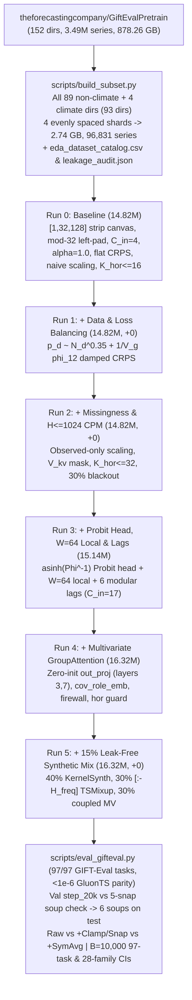
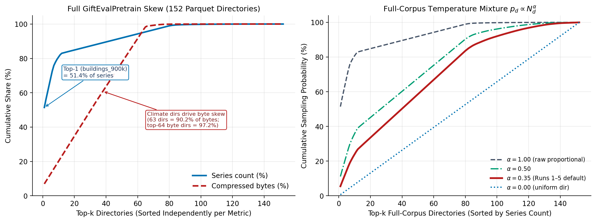
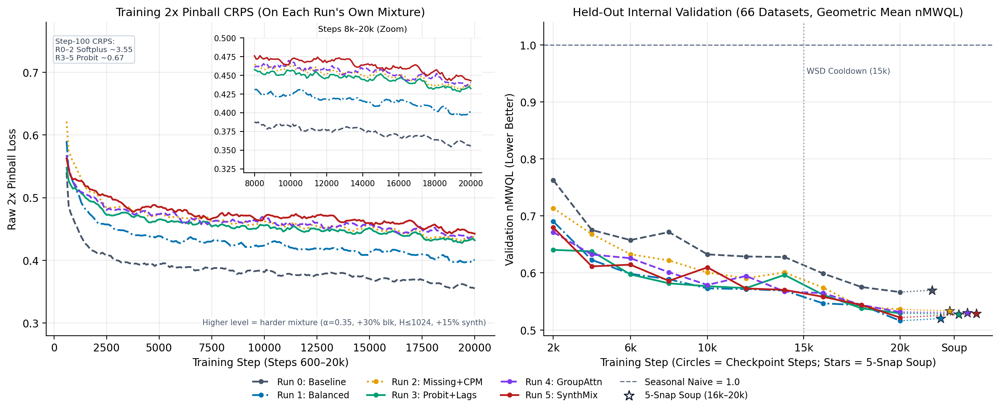

# `gifteval-tsfm-prototype` — Clean, Evidence-Driven Time-Series Foundation Model Prototype

[](tests/)
[-blue)](https://huggingface.co/datasets/theforecastingcompany/GiftEvalPretrain)
[-indigo)](https://huggingface.co/spaces/Salesforce/GIFT-Eval)
[](https://forge.coreweave.com/wandb/aldobattista/gifteval-tsfm-prototype)

A standalone, modular PyTorch time-series foundation model (`TSFMModel`, `14.82M -> 16.32M` parameters) pretrained from scratch on a stratified `2.74 GB` multi-shard subset of [`theforecastingcompany/GiftEvalPretrain`](https://huggingface.co/datasets/theforecastingcompany/GiftEvalPretrain) and evaluated zero-shot across all **`97` official `Salesforce/GIFT-Eval` configurations (`326,490` test windows)**.

Instead of jumping straight to a complex black box, this repository evaluates **6 progressive iterations (`Runs 0..5`)** under identical compute (`20,000` steps each on a single Apple M2 Max laptop), explicitly auditing **every data, normalization, masking, objective, and architectural assumption** with disaggregated slices, `0/20/64`-step blackout stress tests, and paired bootstrap 95% confidence intervals (both 97-task and 28-family cluster-robust).

---

## Executive Summary (5-Minute Read)

- **Overall Zero-Shot Progress (`97` Official `GIFT-Eval` Tasks, Geometric Mean Relative to `Seasonal_Naive`):**
  - `Run 0` (`14.82M` Baseline): **`0.6218` `nMWQL` / `0.8905` `nMASE`** (`Cov80 = 0.768`)
  - `Run 5` (`16.32M` Coupled-Synth + `GroupAttention` + Probit + Local Scale + Lags): **`0.5946` `nMWQL` / `0.8596` `nMASE`** (`Raw Neural`), **`0.5907 / 0.8556`** (`+Clamp/Snap`), and **`0.5890 / 0.8523`** (`+SymAvg+Clamp`, `Cov80 = 0.785`).
  - **Headline Improvement (`Run 5` vs. `Run 0`, `Raw`):** **`-4.37%` `nMWQL`** (97-task paired bootstrap 95% CI `[0.933, 0.979]`; 28-family cluster CI `[0.918, 0.986]`; `69.1%` task win rate) and **`-3.47%` `nMASE`** (task CI `[0.945, 0.986]`; cluster CI `[0.933, 0.992]`; `69.1%` win rate), beating `Seasonal_Naive` on **`90 / 97` (`92.8%`)** tasks on `nMWQL` (`77 / 97` on `nMASE`).
- **Four Core Empirical Takeaways:**
  1. **Corpus & Loss Balancing (`Run 0 -> Run 1`, `0` param delta):** Setting dataset sampling temperature $\alpha = 0.35$ + group-balanced $\phi_{12}$-damped CRPS lowers overall `nMWQL` by **`-3.11%`** (CI `[0.948, 0.988]`), slashing **`Domain: Healthcare` by `-23.6%`** (`0.8749 -> 0.6686`) and **`Domain: Econ/Fin` by `-12.6%`** (`0.9682 -> 0.8463`).
  2. **Missingness Immunity & Single-Pass `H<=1024` (`Run 1 -> Run 2`, `0` param delta):** Observed-only unit-equivariant scaling, blank-key exclusion ($\mathcal{V}_{\text{kv}}$ with `eye_l` fallback), `30%` history blackouts, and $K_{\text{hor}} \le 32$ horizon training cut `20`- and `64`-step pre-origin blackout error by **`-18.6%`** and **`-19.7%`** and raise `Horizon > 512` `Cov80` (`0.664 -> 0.755`), while costing a transparent `+0.42%` clean `nMWQL` capacity tax.
  3. **Analytical Initialization & Dual-Scale Features (`Run 2 -> Run 3`, `+0.32M` params):** Anchoring `MedianAnchoredProbitHead` spacings to $\tilde{z}_q = \sinh^{-1}(\Phi^{-1}(q))$ eliminates Step-0 quantile collapse (`5.3x` lower Step-100 CRPS, `Cov80: 0.2135 -> 0.7264`), while trailing-`64` local scaling and `4`-cycle modular lags recover `nMASE` (`0.8778 -> 0.8713`).
  4. **Why `GroupAttention` Needed `15%` Coupled Synthetic Priors (`Run 4 -> Run 5`):** Real `GiftEvalPretrain` includes `past_feat_dynamic_real` in only `13 / 93` subset directories (`8.5%` of series, `91.0%` concentrated in 3 cloud VM dirs), further gated by `0.35` group-packing probability, leaving `Run 4` under-exposed to cross-series covariates. Adding `15%` synthetic mixtures (`KernelSynth` + truncated `TSMixup` + coupled lead-lag systems) triples `cov_role_emb` norm (`0.130 -> 0.378`) and cuts **`Past Covariates (24 tasks)` by `-7.98%`** (`0.7052 -> 0.6489`) and **`Web/CloudOps (20 tasks)` by `-9.24%`** (`0.7850 -> 0.7125`).
- **Official `97`-Task `GIFT-Eval` Leaderboard Context (`141` Complete Baselines, [gifteval_leaderboard_comparison.csv](results/gifteval_leaderboard_comparison.csv)):** Inserted into the `141`-model leaderboard, `Run 5 (+SymAvg+Clamp)` earns **`#15 / 28`** against the **`27` curated external baselines** (`14` external ahead, `13` external behind; `row 15 / 35` in the combined CSV including `8` own-prototype rows) and **insertion rank `#106` against the `141` official baselines** (`105` ahead, `36` beaten; beating `Seasonal_Naive` on **`90 / 97` (`nMWQL`)** and **`82 / 97` (`nMASE`)**; **`0.5581` `geo_nMWQL` excluding `10S`**). Under `B=10,000` paired bootstrap vs. official baselines, `Run 5 (+SymAvg+Clamp)` achieves statistically significant gains (`p < 0.05` on both `97`-task and `28`-family cluster CIs) over `TimesFM-1.0 (200M)` (`GMR=0.8658`), `Chronos_base (200M)` (`GMR=0.9032`), `Moirai_small (14M)` (`GMR=0.9057`), and `Chronos_large (710M)` (`GMR=0.9099`), scores ahead on aggregate point estimate of `iTransformer` (`0.6203`, `GMR=0.9495`), `Moirai_base (91M)` (`0.6095`, `GMR=0.9664`), `TFT` (`0.6047`, `GMR=0.9740`), and `Moirai_large (311M)` (`0.5989`, `GMR=0.9835`), and statistically ties supervised `PatchTST` (`0.5870`, `GMR=1.0034`, `56/97` task wins; all five within paired `95%` CIs spanning `1.0`), while leaving a quantified `~0.10` gap to frontier models (`Chronos-2` `0.4854` `#61`, `TimesFM-2.5` `0.4903` `#69`, `t0-gamma` `0.4520` `#11`).

### Scope, Compute & Time Calibration
- **Design Choice:** Scoped to `14.82M–16.32M` parameters and a `2.74 GB` stratified `93`-directory subset (`96,831` capped Parquet segments, `~2.8%` of full-corpus series / `0.31%` of bytes) so all `6` `20k`-step progressive runs fit cleanly on one laptop (`~7` hours hands-on engineering; `~8.9` hours sequential final pipeline compute [`39.3m` subset + `~7.76h` training (`7.70h` TB scalar span) + `~30m` 6-soup eval], `~10.4` hours total unattended compute including early diagnostic runs).
- **Single-Seed Disclosure:** Each iteration trains once at `seed = 42`; all paired bootstrap 95% CIs (`B = 10,000`) quantify task and dataset-family sampling uncertainty rather than multi-seed variance. Similarly, the `5`-snapshot cooldown soup rule (`16k..20k`) was frozen upfront before seeing `GIFT-Eval` (`3–3` internal validation split across `Runs 0..5`).

---

## Architecture & Progressive Iteration Flow



---

## Assumption-to-Evidence Traceability Matrix

| Design Choice / Assumption | First-Principles Justification | Verification & Code Evidence | Reference Connection |
| :--- | :--- | :--- | :--- |
| **1. Stratified `2.74 GB` Multi-Shard Subset (`93` dirs)** | `90.2%` of `878.26 GB` is `63` climate dirs and `51.4%` of series are `buildings_900k`; keeping `100%` of `67` small/med datasets ($\le 2\text{k}$) + `4` spaced shards preserves rare frequencies locally. | [build_subset.py](scripts/build_subset.py), [eda_dataset_catalog.csv](results/eda_dataset_catalog.csv), [Notebook 01](notebooks/01_data_pipeline_walkthrough.ipynb) | `Moirai` (`LOTSA`), `tfc-t0` |
| **2. Zero-Leakage Audit + `[:-H_freq]` Val Holdout** | `clean_disjoint_verified: true` (`0` family overlaps; `0` non-degenerate z-64 collisions; `4` binary 2-level step collisions); permanently truncates `[:-H_freq]` off `1,500` series across `66` datasets (`790` have paired `__recent`/`__hist` mates in the subset; `1,425` have zero exact `[-H_freq:]` mate-tail sequence collisions in `train_views` [`0.5662 -> 0.5301` `Run 5` vs `0.5289` `Run 4` Point-SN `nMWQL`], and `1,336` remain after excluding `89` non-constant cross-dir upstream duplicates [`0.5631 -> 0.5281` `Run 5` vs `0.5267` `Run 4`] vs. `0.5696 -> 0.5289` on all `1,500`; new indices exclude `__hist`). | [leakage_audit.json](results/leakage_audit.json), [data.py](src/tsfm_proto/data.py), [test_data_and_leakage.py](tests/test_data_and_leakage.py) | `GIFT-Eval`, `TimesFM` |
| **3. $\alpha=0.35$ Balancing & $1/V_g$ Damped CRPS** | Compresses max/min sampling ratio from `2500x` to `15.5x` and bounds sensor outliers with $\phi_{12}(s) = 12 \ln(1 + s/12)$. | `Run 0 -> Run 1`, [loss.py](src/tsfm_proto/loss.py), [Notebook 01](notebooks/01_data_pipeline_walkthrough.ipynb) | `Moirai`, `Chronos` |
| **4. $P=32$, `[1, 32, 128]` Strip & Mod-32 Left-Pad** | `left_pad = (-T_ctx) % 32` locks $T_{\text{origin}}$ at index `31` of `rel_patch_idx = 0` for every $T_{\text{ctx}} \ge 1$ with **`~99.6%`** strip occupancy. | [packing.py](src/tsfm_proto/packing.py), [test_causality_and_masks.py](tests/test_causality_and_masks.py), [Notebook 01](notebooks/01_data_pipeline_walkthrough.ipynb) | `TimesFM`, `tfc-t0` |
| **5. `rel_origin_pos` Stem Channel (`C_in >= 4`)** | `RoPE` rotates `Q` and `K` only; `rel_origin_pos` (`ch 3`) disambiguates Layer-0 residual horizon slots `+1..+K` on 1-patch short series. | [scaling.py](src/tsfm_proto/scaling.py), [Notebook 02](notebooks/02_model_invariants_and_overfit_check.ipynb) | Extends `Chronos-2` & `tfc-t0` |
| **6. Unit-Equivariant Scaling, `eye_l` $\mathcal{V}_{\text{kv}}$ & Blackouts** | Preserves machine-precision invariance in `float64` scalar moments/`arcsinh` (`1.50e-15` on `NB01`'s micro-SI test; $\mathcal{O}((\lvert\mu\rvert/\sigma)\epsilon_{\text{f64}})$ generally) and `< 5e-5` across tested SI rescalings in `float32`-cast patch features (`0.0` on powers of two, `~9e-7` in `NB01`, `1.32e-5` in `test_causality_and_masks.py`) whenever rescaled series stay strictly above the `1e-12` underflow floor, excludes blanked keys safely on `100%`-NaN crops, and trains up to $H=1024$ with `30%` `20..64`-step blackouts. | `Run 1 -> Run 2`, [model.py](src/tsfm_proto/model.py), [eval_metrics.py](src/tsfm_proto/eval_metrics.py) | `Timestral`, `Moirai`, `tfc-t0` |
| **7. `arcsinh`-Probit Head, `W=64` Local & 6 Lags** | `z_tilde = asinh(Phi^-1(q))` cuts Step-0 CRPS `~10x` (`~0.44` vs `~4.44`, `Cov80 ~ 80%`; Step-100 CRPS `5.3x`: `0.671` vs `3.546`); `W=64` local scaling & 4-cycle modular lags resist blackouts & patch phase drift. | `Run 2 -> Run 3`, [heads.py](src/tsfm_proto/heads.py), [Notebook 02](notebooks/02_model_invariants_and_overfit_check.ipynb) | `Chronos-2`, `Sundial` |
| **8. `GroupAttention` + Firewall + Observed-Peer Guard** | Zero-init `out_proj`, two-timescale LR, `has_group_peer`, `~(icov_q & ~icov_k)`, and `key_ok = obs \| (is_hor & ~icov)` exploit covariates safely without corrupting univariate rows. | `Run 3 -> Run 4`, [model.py](src/tsfm_proto/model.py), [test_causality_and_masks.py](tests/test_causality_and_masks.py) | `Chronos-2`, `TabICL` |
| **9. `15%` Coupled Synthetic Augmentation (`Run 5`)** | Overcomes `13 / 93` real `past_cov` sparsity (`8.5%` series; `KernelSynth` + `TSMixup` + coupled lead-lag MV systems) cleanly without touching val tails. | `Run 4 -> Run 5`, [synthetic.py](src/tsfm_proto/synthetic.py), [docs/03](docs/03_evaluation_and_error_analysis.md) | `Chronos`, `Chronos-2` |
| **10. `< 1e-6` GluonTS Parity & Dual Bootstrap CIs** | Exact vectorized `GIFT-Eval` scorer verified `< 1e-6` against `gluonts`, auditing soup selection on `1,500` val series and separating `+Clamp/Snap` vs. signed `+SymAvg`. | [eval_gifteval.py](scripts/eval_gifteval.py), [results/](results/), [Notebook 03](notebooks/03_checkpoint_eval_and_forecasts.ipynb) | `GIFT-Eval`, `TimesFM` |

---

## Comparison Against Reference Repositories

| Repository | Shared Principles in `gifteval-tsfm-prototype` | Explicit Architectural & Objective Contrast |
| :--- | :--- | :--- |
| **`Moirai` (`uni2ts`)** | Any-variate cross-series attention + `LOTSA`-style corpus skewness mitigation, missingness masking | Uses causal temporal attention + fixed $P=32$ with 4-cycle modular lags instead of multi-patch projections (`8..128`) and non-parametric `Q21` Probit quantiles instead of Student-$t$ mixtures |
| **`TimesFM`** | Causal $P=32$ patching, left-padding alignment, multi-step quantile prediction | `TSFMModel` uses parallel masked horizon slots in a causal Transformer (vs. decoder-only autoregressive patching), replaces `RevIN` + zero-fill with unit-equivariant `arcsinh`, blank-key $\mathcal{V}_{\text{kv}}$ isolation, and `GroupAttention` |
| **`Chronos-2`** | Multi-channel stem symmetry breaking (`rel_origin_pos`), `GroupAttention` over targets/covariates, `arcsinh` `Q21` pinball, `KernelSynth`/`TSMixup`, reflection symmetry | Causal `P=32` `16.32M` single-stream model (vs. `Chronos-2`'s `120M` bidirectional `P=16` encoder), adding `W=64` local scaling, 4-cycle modular lags, and signed-only `+SymAvg` |
| **`Timer` / `Sundial` (`OpenLTM`)** | Unified long-context sequence modeling (`4,096` steps/strip) across frequencies | Replaces autoregressive next-patch / `TimeFlow` flow-matching heads with parallel masked horizon slots, exact $2\times$ pinball CRPS, and `20..64`-step blackout resilience |
| **`TabICL`** | Column-wise set/group attention with order-invariant peer aggregation | `[1, R, L]` swaps row/column axes relative to `TabICL` (`GroupAttention` runs across variate axis `R`); inspires Pillar 7's `50%` zero-MI decoy SCM curriculum |
| **`Timestral`** | Single-pass multi-horizon calibration up to $H \le 1024$ | Captures multi-horizon calibration via term-stratified suffix budgets ($50\% / 25\% / 25\%$) over masked horizon slots (vs. `Timestral`'s 2-stream `DHF` + Advancing Refine Frame) |
| **`tfc-t0`** | Unified `target` + `past_feat_dynamic_real` schema, `arcsinh` scaling, strip packing, 2D attention | Distills core mechanics cleanly at `~15M` scale while isolating `eye_l` blank-key safety, Probit calibration, horizon covariate guards, and 97-task attribution |

---

## Official 97-Task `GIFT-Eval` Progressive Results

Geometric-mean `nMWQL` and `nMASE` (lower is better; normalized per task by official `Seasonal_Naive`) and mean 80% coverage across all `97` tasks (`326,490` windows):

| Iteration | Params | Raw `nMWQL` | Raw `nMASE` | Raw `Cov80` | `+Clamp/Snap` `nMWQL / nMASE` | `+SymAvg+Clamp` `nMWQL / nMASE` | Key Slice Highlight |
| :--- | :---: | :---: | :---: | :---: | :---: | :---: | :--- |
| `run0_v0_baseline` | `14.82M` | `0.6218` | `0.8905` | `0.7677` | `0.6188 / 0.8873` | `—` | End-to-end anchor |
| `run1_data_balanced` | `14.82M` | `0.6025` | `0.8664` | `0.7609` | `0.5992 / 0.8635` | `—` | **`Healthcare -23.6%`**, **`Econ/Fin -12.6%`** |
| `run2_missingness_suffix_cpm` | `14.82M` | `0.6050` | `0.8778` | **`0.7911`** | `0.6018 / 0.8755` | `—` | **`20`/`64`-blk `-18.6%` / `-19.7%`** |
| `run3_probit_localscale_lags` | `15.14M` | `0.6074` | `0.8713` | `0.7731` | `0.6038 / 0.8679` | `—` | **`5.3x` lower init CRPS**, `nMASE` recovery |
| `run4_multivariate_group_attn` | `16.32M` | `0.6047` | `0.8678` | `0.7749` | `0.6010 / 0.8647` | `0.5998 / 0.8624` | `Low-Res A/Q/M/W: 0.7397 (-10.0%)` |
| **`run5_coupled_synth_mix`** | `16.32M` | **`0.5946`** | **`0.8596`** | `0.7789` | **`0.5907 / 0.8556`** | **`0.5890 / 0.8523`** | **`Past Cov -7.98%`**, **`CloudOps -9.24%`**, `#1` overall |

*Note on `Run 2 -> Run 3`:* While 97-task `nMWQL` ticked up `+0.38%` (`0.6050 -> 0.6074`), `Run 3` beat `Run 2` on internal validation (`0.5333 -> 0.5277`), on `97`-task `nMASE` (`0.8778 -> 0.8713`), on `56.7%` of tasks, and lowered **`91`-task non-`10S` `nMWQL` by `-1.30%`** (`0.5740 -> 0.5665`, beating `Run 1`'s `0.5706`). The net `+0.38%` overall uptick (`-1.30%` on `91` tasks offset by `+29.8%` on `6` tasks) came entirely from high-variance amplification on the `6` unseen `10S` tasks (`0 / 152` `10S` dirs in pretraining) before `Runs 4–5` regularized them (`1.7451 -> 1.3363`).

### Paired Bootstrap 95% CIs (`B = 10,000, seed = 42`, `Raw Neural`)

- **`Run 1` vs `Run 0`:** `nMWQL` `-3.11%` (97-task CI `[0.948, 0.988]`, 28-family cluster CI `[0.937, 0.991]`, `68.0%` win rate); `nMASE` `-2.71%` (`[0.955, 0.990]`, cluster `[0.947, 0.994]`, `65.0%` win rate).
- **`Run 5` vs `Run 4`:** `nMWQL` `-1.67%` (97-task CI `[0.968, 0.999]`, 28-family cluster CI `[0.957, 1.004]`, `55.7%` win rate); `nMASE` `-0.94%` (`66.0%` win rate).
- **`Run 5` vs `Run 0`:** `nMWQL` **`-4.37%`** (97-task CI `[0.933, 0.979]`, 28-family cluster CI `[0.918, 0.986]`, `69.1%` win rate); `nMASE` **`-3.47%`** (`[0.945, 0.986]`, cluster `[0.933, 0.992]`, `69.1%` win rate). *(Single `seed=42` training runs; CIs capture task/family sampling uncertainty.)*

---

## Key Figures





- **Top-100 Zero-Shot Forecast & Covariate Ablation Showcase Book (`Run 5 +SymAvg+Clamp`):** Browse all 50 univariate and 50 multivariate with-vs-without-covariates plates in [results/forecast_showcase_book/README.md](results/forecast_showcase_book/README.md) or download the 108-page vector compendium [Run5_Top100_Forecast_Showcase_Book.pdf](results/forecast_showcase_book/Run5_Top100_Forecast_Showcase_Book.pdf).

---

## Quickstart & Exact Reproduction

```bash
# 1. Install in editable mode + official GIFT-Eval loader for fresh clone reproduction
pip install -e ".[eval,dev]"
pip install git+https://github.com/SalesforceAIResearch/gift-eval.git

# 2. Verify all 34 invariance, leakage, causality, GroupAttention, Probit, packing, and GluonTS parity tests
# (29 passed, 5 skipped on a fresh clone prior to subset/checkpoint build; 34/34 passed once artifacts exist)
python -m pytest -v

# 3. Optional: download GIFT-Eval test benchmark & build the 93-directory 2.74 GB stratified subset
# huggingface-cli download Salesforce/gift-eval --repo-type dataset --local-dir data/GiftEval
# export GIFT_EVAL="$(pwd)/data/GiftEval"
PYTHONPATH=src python scripts/build_subset.py

# 4. Train any progressive iteration (e.g. Run 5, ~79 min step compute on Apple M2 Max bfloat16 MPS)
PYTHONPATH=src python scripts/train.py --config configs/run5_coupled_synth_mix.yaml

# 5. Evaluate checkpoints on GIFT-Eval (or regenerate summary CSVs/plots offline without binary weights)
# Note: binary *.safetensors checkpoints & data/ are gitignored; mount GIFT_EVAL and pass --checkpoints
# or download/train checkpoints locally, or run `--recompute-summaries-only` on committed CSVs:
PYTHONPATH=src python scripts/eval_gifteval.py --recompute-summaries-only
PYTHONPATH=src python scripts/export_plots.py
# With GIFT_EVAL + trained checkpoints present:
PYTHONPATH=src python scripts/eval_gifteval.py --smoke --batch-size 64
PYTHONPATH=src python scripts/eval_gifteval.py --batch-size 64
PYTHONPATH=src python scripts/generate_showcase_book.py

# 6. Validate checkpoint staging for Hugging Face Hub
PYTHONPATH=src python scripts/upload_hf.py --repo-id user/gifteval-tsfm-proto --dry-run
```

---

## Repository Guide & With More Time (Priority 0 + 12-Pillar Scaling Roadmap)

- **Core Library ([src/tsfm_proto/](src/tsfm_proto/)):** `config.py`, `data.py`, `synthetic.py`, `scaling.py`, `packing.py`, `model.py`, `heads.py`, `loss.py`, `eval_metrics.py`, `hub.py`.
- **Executed Interactive Walkthroughs ([notebooks/](notebooks/)):**
  - [01_data_pipeline_walkthrough.ipynb](notebooks/01_data_pipeline_walkthrough.ipynb) — Corpus skew, leakage checks, $\alpha=0.35$, scale equivariance, `W=64` lags & `[1,32,128]` packing.
  - [02_model_invariants_and_overfit_check.ipynb](notebooks/02_model_invariants_and_overfit_check.ipynb) — Causality, 1-patch `V` symmetry breaking, `100%`-NaN safety, Step-0 Probit fan, `GroupAttention` firewall & overfit curve.
  - [03_checkpoint_eval_and_forecasts.ipynb](notebooks/03_checkpoint_eval_and_forecasts.ipynb) — Offline-first loading, val `step_20k` vs. soup, official leaderboard table, 97-task CIs, live blackout & covariate forecast gallery, residual failure inspection.
- **Top-100 Forecast Showcase Book ([results/forecast_showcase_book/](results/forecast_showcase_book/)):** [Catalog & Gallery](results/forecast_showcase_book/README.md) | [108-Page Vector PDF](results/forecast_showcase_book/Run5_Top100_Forecast_Showcase_Book.pdf) | [scripts/generate_showcase_book.py](scripts/generate_showcase_book.py).
- **Technical Deep Dives & Candid Log:** [WORKLOG.md](WORKLOG.md) | [docs/01_data_pipeline_and_eda.md](docs/01_data_pipeline_and_eda.md) | [docs/02_architecture_and_ablations.md](docs/02_architecture_and_ablations.md) | [docs/03_evaluation_and_error_analysis.md](docs/03_evaluation_and_error_analysis.md)
- **With More Time ([docs/04_with_more_time_roadmap.md](docs/04_with_more_time_roadmap.md)):** Full equation-backed production blueprint covering **Priority 0** quick wins + **12 vetted scaling pillars** (`3:1` interleaved gated delta-rule `Kalman-KDA` recurrence + pointwise-gated `HSTU` / `XPOS` full attention for `32k+` `10S` memory, known-future covariates $\mathbf{z}$ with `2*sigmoid` decoy gate & calendar rate normalization, `4x8` `u-µP` sub-patch residual stem, Björck rolling `W=64` + origin-blended readout frame, quadrature `Spline-IQF` + extreme tails + copula/`MinT` sums, `5`-anchor quadrature for $H > 1024$, retail Tobit stockouts + zero-preserving `TSMixup` + `50%` zero-MI SCM decoys, `3`-gate decontamination across `GIFT-Eval` + `fev-bench` + `TIME`, 2D BFD rectangle vs. 1D jagged `FlexAttention` packing, `NorMuon` + update-sign `CWD` + `u-µP` + `OnlineEMA`, dense multi-origin causal supervision + `70/30` `CPM`, and dual-cadence `P=16/P=8` low-res stem adapters [sharing `P=32` weights] + `RAF` + `LoRA`) plus **6 empirical guardrails**.
